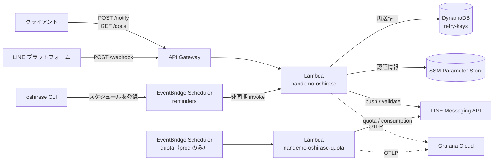

# アーキテクチャ

## システム構成

| コンポーネント | 役割 |
|---|---|
| API Gateway | `POST /notify`（API キーが必要）、`GET /docs`、`POST /webhook`（LINE プラットフォームから呼ばれる）を Lambda に渡す |
| Lambda `{env}-nandemo-oshirase`（`src/nandemo_oshirase`） | メッセージを LINE に送る。API Gateway と EventBridge Scheduler の両方から呼ばれる |
| DynamoDB `{env}-nandemo-oshirase-retry-keys` | [再送](#再送冪等性)のための再送キーを15分間保存する |
| SSM Parameter Store | LINE の認証情報。Lambda が実行時に読む（[デプロイ](deployment.md)） |
| EventBridge Scheduler `{env}-nandemo-oshirase-reminders` | [定時お知らせ](#定時お知らせ)のスケジュール。`oshirase` CLI（`src/oshirase_cli`）が登録する |
| Lambda `{env}-nandemo-oshirase-quota`（`src/nandemo_oshirase_quota`） | [LINE の利用数](#line-の利用数の監視)を取得して Grafana Cloud に送る |
| Grafana Cloud | トレース・メトリクス・ログの送り先（[デプロイ](deployment.md)） |

インフラは `tf/` の Terraform で管理しています。

## 再送（冪等性）

利用者から見た振る舞いは [使い方](usage.md#再送) を見てください。

5件ずつのまとまりごとに、LINE の再送キー（`X-Line-Retry-Key`）を DynamoDB に15分間保存し、再送では同じ再送キーで LINE に送ります。送信済みの再送キーなら LINE は送らずに `409` を返すので、送信済みとして扱います。同時に届いたリクエストも、DynamoDB の条件付き書き込みで同じ再送キーになります。

## 定時お知らせ

定時のお知らせは、EventBridge Scheduler から Lambda を直接 invoke して送ります（使い方は [使い方](usage.md#定時お知らせoshirase-cli)）。

送信時刻とメッセージは AWS 上の EventBridge Scheduler にだけ保存され、このリポジトリや Terraform state には残りません。Terraform が管理するのはスケジュールグループ（`{env}-nandemo-oshirase-reminders`）と Scheduler 用 IAM ロールだけです。

- スケジュールは Lambda に `{"source": "nandemo-oshirase.scheduler", "messages": [...]}` を非同期で invoke します。`--dry-run` のお知らせは `"dry_run": true` も付き、Lambda は [POST /notify の dry run](usage.md#dry-run) と同じく validate API で確認するだけで送信しません。
- 送信に失敗すると Lambda はエラーになり、1回だけリトライします。1時間以上遅れたお知らせは送りません。
- リトライでは、[再送](#再送冪等性)と同じく送信済みのメッセージを送りません。

## LINE の利用数の監視

LINE の月の送信数の上限（無料プランは 200 通）に近づいていることに気づけるよう、当月の利用数と上限を Grafana Cloud で監視しています。

- 別の Lambda（`{env}-nandemo-oshirase-quota`、コードは `src/nandemo_oshirase_quota`）が、LINE の [quota](https://developers.line.biz/ja/reference/messaging-api/#get-quota) と [quota/consumption](https://developers.line.biz/ja/reference/messaging-api/#get-consumption) の API を呼び、OTel のメトリクスとして送ります。どちらも読み取りだけなので、送信数は使いません。

  | メトリクス（Prometheus） | 値 |
  |---|---|
  | `line_quota_consumption` | 当月に送ったメッセージの数（概算。LINE Official Account Manager から送った分も含む） |
  | `line_quota_limit` | 当月の上限の目安（上限が設定されていないときは送らない） |

- 定時実行は **prod だけ**で、毎日 23:55（Asia/Tokyo）に取得します。dev と prod は同じ LINE チャネル（同じ上限）を使っているためです。dev には定時実行がなく、CD のデプロイのあとに1回呼ぶだけです。
- dev と prod は同じ値を送るので、Grafana では **環境をまたいで足さず**、`deployment_environment_name="prod"` の値だけを使います。値は Lambda の実行環境ごとに別の系列（`service_instance_id`）になるので、`max by (deployment_environment_name) (...)` でまとめてから最新の値を取ります。
