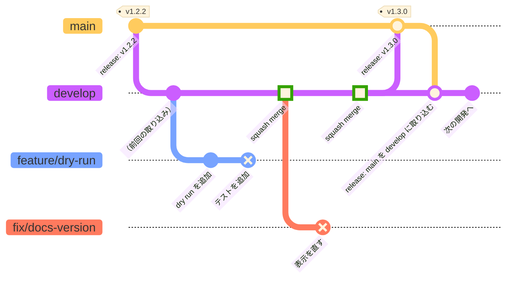

# リリース（タグと GitHub リリース）

本番にデプロイしたものに、SemVer のタグ（`vX.Y.Z`）を打ち、GitHub リリースを作ります。

## 開発からリリースまでの流れ

※ feature・fix のブランチは develop にスカッシュでマージするので、ブランチのコミットはそのままでは develop に入らず、develop には PR ごとに1つのコミット（■）だけが残ります。図ではそれを、ブランチの最後のコミット（×）と、develop のスカッシュのコミット（■）で表しています。main → develop の取り込みは、実際には main と同じコミットを指す一時的なブランチ（`back-merge/<sha>`）からの PR で行います。

| ブランチ | 役割 | マージの仕方 | デプロイ |
|---|---|---|---|
| `main` | 本番にデプロイしたものの履歴。リリースのタグ（`vX.Y.Z`）はここのマージコミットに打つ | develop からのリリース PR を「Create a merge commit」でマージ | 本番（prod）。デプロイが成功すると CD がタグとリリースを作る |
| `develop` | 開発の本流。feature・fix の PR はここに向ける | feature・fix の PR はスカッシュでマージ | 開発環境（dev） |
| `feature/*`・`fix/*` など | 1つの変更のための作業ブランチ。develop から切る | PR のタイトルは Conventional Commits の形（`feat: ...`、`fix: ...`）。タイトルのラベルで次のバージョンが決まる | なし（CI だけ） |
| リリース PR（develop → main） | リリース用のブランチは作らず、develop をそのまま main に PR する。「Create release PR」のワークフローが作る | 人が「Create a merge commit」でマージ | マージが本番のデプロイになる |
| `back-merge/<sha>`（図では main → develop のマージ） | リリースの後、main（タグの付いたコミット）を develop に取り込むための一時的なブランチ。CD が作り、マージ後に消える | CD がマージコミットで自動マージ（失敗したときは人がマージ） | なし |

手順で書くと、次のようになります。

1. develop から作業ブランチを切り、develop への PR を作ります。PR のタイトルは `feat: ...`・`fix: ...` などにします。
2. PR を develop にスカッシュでマージします。develop の CD が開発環境にデプロイします。
3. リリースすると決めたら、Actions の「Create release PR」を手で実行します。`release: vX.Y.Z (develop → main)` の PR ができます。
4. リリース PR を「Create a merge commit」でマージします。main の CD が本番にデプロイし、成功するとマージコミットに `vX.Y.Z` のタグを打ち、GitHub リリースを作ります。
5. CD が `back-merge/<sha>` から develop への PR を作り、マージコミットでマージします。これで develop の履歴からもタグを辿れるようになります。

## 詳細

- main へのマージで本番のデプロイが成功すると、CD（`.github/workflows/cd.yml`）が次のバージョンのタグを打ち、リリースを作ります。バージョンは、前のタグからの PR のラベルで決めます（`breaking`: メジャー、`feat`: マイナー、それ以外: パッチ）。
- 手で `v*.*.*` のタグを push したときは、`.github/workflows/release.yml` がリリースを作ります。
- どちらも [zaki3mymy/actions](https://github.com/zaki3mymy/actions) の再利用ワークフロー（`next-tag.yml`、`create-release.yml`）を使います。
- PR のタイトルは Conventional Commits の形（`feat: ...`、`fix(cli): ...` など）にします。`.github/workflows/label-pr-by-title.yml` がタイトルからラベルを付けます（形が違うときは失敗します）。develop から main へのリリース PR は `release: ...` にします。リリースすると決めたら、Actions の「Create release PR」（`.github/workflows/release-pr.yml`）を手で実行すると、次のバージョンを決めて `release: vX.Y.Z (develop → main)` の PR を作ります（開いていれば更新します）。本文は `.github/release.yml` の見出しで振り分けたリリースノートです。マージは「Create a merge commit」で行います。
- リリースノートは GitHub の自動生成で、PR のラベル（`breaking`・`feat`・`fix`・`dependencies`）ごとの見出しに振り分けます（`.github/release.yml`）。`skip-release-notes` の付いた PR（develop から main へのリリース PR など）は載りません。
- タグは main のマージコミットに打ちます。ノートの生成とリリースの作成には、タグのコミットにある `.github/release.yml` と `.github/workflows/release.yml` が使われます。
- リリースの後、CD（`.github/workflows/back-merge.yml`）が main → develop の PR を作り、マージコミットでマージします（タグを develop の履歴からも辿れるようにするため）。自動のマージに失敗したとき（コンフリクトなど）は、PR が開いたまま残り（オーナーにアサイン）、CD が失敗します。その PR は「Create a merge commit」でマージしてください。手で取り込むときは、Actions から「Back-merge main into develop」を実行します。
- パッケージのバージョン（`pyproject.toml`）は書かず、setuptools-scm で git のタグから決めます。タグのコミットでは `1.2.1`、それより後のコミットでは `1.2.2.dev3+gabc1234` のようになります。
- `/docs` に表示するバージョンは、ドキュメントのビルド時（`scripts/build-docs.sh`）に `openapi.yaml` の `info.version` に入れます。`openapi.yaml` にはプレースホルダー（`0.0.0-dev`）だけを書き、バージョンは書きません。本番（main）の CD は、デプロイの前に次のバージョンを決めて（タグはデプロイの後に打ちます）その値（例: `v1.3.0`）を、develop の CD は `git describe --tags` の値（例: `v1.2.1-3-gabc1234`）を入れます。ローカルのコンテナでは `dev` になります（`--build-arg VERSION=...` で変えられます）。
